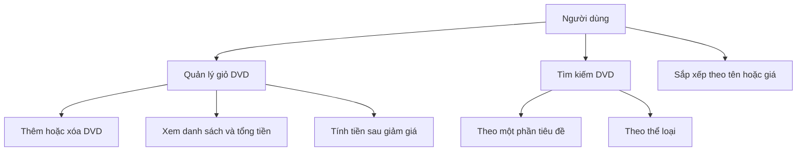

# Ca sử dụng — Quản lý giỏ DVD

Tác nhân là người dùng chương trình dòng lệnh. Dữ liệu nằm trong bộ nhớ và
chỉ tồn tại trong lần chạy; ứng dụng chưa có tài khoản hoặc bước thanh toán.

## Thêm DVD

1. Chọn thông tin DVD cần đưa vào giỏ.
2. Kiểm tra sức chứa tối đa 20 DVD.
3. Nếu còn chỗ, thêm DVD và trả True; nếu đầy, giữ nguyên giỏ và trả False.

## Xóa DVD và xem giỏ

Một lần xóa bỏ một phần tử khớp; nếu không tìm thấy thì trả False. Giỏ rỗng
hiển thị `The cart is empty`. Giỏ có dữ liệu hiển thị số DVD, danh sách đánh
số và tổng tiền với hai chữ số thập phân.

## Tra cứu và tính tiền

Tìm tiêu đề theo chuỗi con, tìm thể loại theo tên đầy đủ; bản hiện tại không
phân biệt hoa thường. Kết quả tìm kiếm là danh sách mới. Giảm giá chỉ chấp nhận
0–100%; sắp xếp giữ nguyên các DVD và tổng giá trị giỏ.
